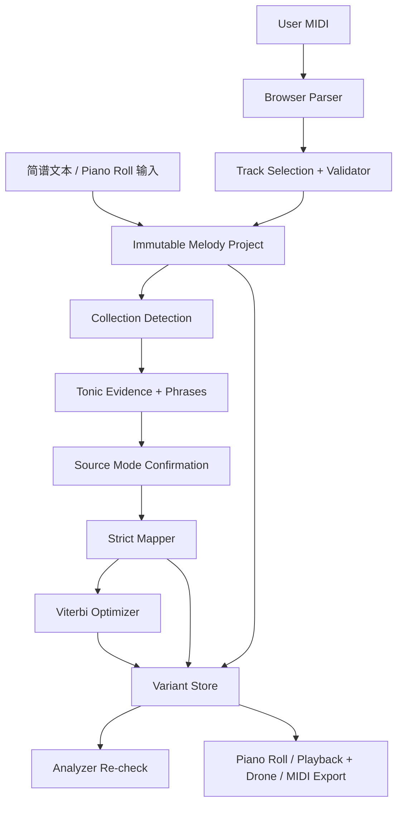

# ReMode — 单声部 MIDI 调式分析、转换与旋律重构工作台

> **Same Melody. Different Mood.**  
> 项目状态：产品与技术规格草案 v1.1  
> 更新日期：2026-11-03  
> 目标：纯浏览器端、Local-first、可离线、可解释、可导出的旋律实验室（Cloudflare Pages 静态部署）
>
> **v1.1 主要变更**：调式识别改为“音集 + 主音”两步法；默认操作为同主音换调式；新增特征音显著度与动机绑定；首发支持全部七个教会调式与中国六声/七声数据结构；试听加入主音持续低音（drone）；新增简谱文本输入；AI 移出 v1。见第 15 章 ADR-004、ADR-007、ADR-012～ADR-016。

---

## 0. 执行摘要

ReMode 是一个以 **单声部旋律（monophonic melody）** 为核心的 MIDI Web 应用。用户上传 MIDI、用简谱文本或钢琴卷帘输入旋律后，可识别候选主音与调式、主动纠正判断、进行同主音换调式、移调或同音集换主音，通过钢琴卷帘直观查看差异，在同一时间轴（可叠加主音持续低音）试听原曲和多个改写版本，最后导出标准 MIDI。

**产品定位**：不是简单的 Transpose 工具，而是 **Melody Mode Lab（旋律调式实验室）**。

**基本原则**：

1. **Local-first**：上传、解析、分析、转换、规则优化、试听与导出默认在浏览器执行；无需注册、无需云端存储。
2. **Music-theory-first**：算法方案完整可用；v1 不含 AI（见第 9 章）。
3. **Non-destructive**：原始旋律与 MIDI 元数据不可变；每次生成新版本；支持撤销、重做、对比。
4. **Explainable**：每个自动改动都能够展示原因、前后音高、代价/约束。
5. **Honest uncertainty**：调式识别是推断，不能将相关系数当作真实概率。结果有歧义时主动显示候选并支持人工指定。
6. **Export fidelity**：默认只改音高，保留时间 Tick、持续 Tick、力度、速度图谱、拍号等，除非用户明确选择进一步编辑。
7. **Cloudflare-friendly**：纯静态应用部署在 Cloudflare Pages；v1 无后端、无 Worker、无密钥。
8. **Audible modality**：单旋律缺少和声参照时调式差异不易听出；试听提供可开关的主音持续低音（drone），让调式色彩可被听见。

**项目非目标（首发不做）**：从 WAV/MP3 直接识别音符、复杂复音或完整和声编配、专业 DAW 级别编辑、无条件保证传统中国调式的风格真实性、替代音频母带工具。

---

## 1. 用户场景与价值

### 1.1 核心场景

- **调式探索**：将一段 C Ionian 旋律改写为 C Dorian、C Lydian、C Mixolydian 或 C 羽调式等，理解音级角色与特征音的变化。
- **创意实验**：比较严格音级映射与规则优化版（含特征音引入）之间的听感差异。
- **快速输入**：不需要 DAW，直接用简谱文本或钢琴卷帘写一段旋律进行实验。
- **教学与学习**：查看音级分布、终止倾向、候选主音、乐句和修改原因。
- **创作者工作流**：导入 DAW 导出的 melody MIDI，改写后下载、回到 DAW 继续制作。
- **离线隐私**：原始 MIDI 与输入旋律始终留在浏览器，不发送给任何第三方。

### 1.2 核心用户旅程

1. 拖入或选择 `.mid` / `.midi` 文件，或输入简谱文本，或在钢琴卷帘上新建旋律。
2. 解析轨道，找出可用的单声部候选；若多轨则引导选轨，不必直接报错。
3. 校验重叠、异常音符、音域和控制器事件；给出修复建议和预览。
4. 自动分析兼容音集与主音候选，显示候选、主音证据和结构性歧义（如“缺第 4、7 级，无法区分 Ionian / Lydian / Mixolydian”）；用户可手动指定。
5. 选择转换操作（默认同主音换调式；或移调、同音集换主音）、目标调式和旋律保真度。
6. 生成 Original、Strict、Expressive；若旋律未使用目标特征音，提示 Strict 不会产生听感差异。
7. 对齐同一时间轴，切换试听（可开启主音持续低音）；使用钢琴卷帘查看差异、循环乐句、手动修音。
8. 查看改写清单和统计，选择单个或批量导出 MIDI。

### 1.3 首发验收条件

- 在无账号、无 API Key、无后端请求时能够完成端到端的解析、识别、转调、跨调式改写、试听及导出。
- 输入严格单声部 MIDI 后，不出现无意丢音、不合理变速和无法导出的情况。
- 用户能纠正来源调式而不重新上传文件。
- 对无法判断主音、无法无损处理的文件给出明确说明，而不是强行成功。

---

## 2. 功能范围与优先级

| 优先级 | 模块 | 具体能力 | 交付阶段 |
|---|---|---|---|
| P0 | 导入 | 拖拽上传、MIDI 解析、轨道列表、单声部检测、异常提示 | M0–M2 |
| P0 | 调式库 | 七个教会调式、中国五声五调；六声/七声（清乐、雅乐、燕乐）数据结构与“宫系统 + 主音”命名 | M0 |
| P0 | 音乐分析 | 音集识别 + 主音证据两步法、结构性歧义说明、人工纠正 | M0–M2 |
| P0 | 严格转换 | 同主音换调式（默认）、移调、按音级身份映射、七声↔五声、特征音曝光检查、音域保护 | M1 |
| P0 | 简谱输入 | 简谱文本解析为 MelodyNote（CLI 与 fixture 先用，后接 UI） | M1–M2 |
| P0 | 试听比较 | Original / Strict / Expressive、共享时间轴、A/B 切换、主音持续低音 | M2–M3 |
| P0 | 可视化 | Piano Roll、音符差异高亮、音级统计 | M2 |
| P0 | 导出 | 标准 MIDI 导出、尽可能保留原有节奏和 Header | M1–M2 |
| P0 | 手动编辑 | 卷帘新建/删除音符、单音拖拽调整音高、撤销/重做、恢复原样 | M2–M3 |
| P1 | 规则优化 | 乐句、候选音、二阶 Viterbi、特征音显著度、动机绑定、同音集换主音、代价分解解释 | M3 |
| P1 | 保真度 | Faithful–Creative 滑块映射优化器权重与约束 | M3 |
| P1 | 评测校准 | 带标签语料校准主音证据、盲听 A/B 偏好记录 | M4 |
| P1 | 体验增强 | 乐句循环、导出差异报告、音色切换、历史版本、简谱显示 | M3–M5 |
| P2 | 离线 | PWA、缓存核心静态资源和轻量音色 | M5 |
| P2 | 风格预设 | Bright / Melancholic / Mysterious / Traditional 等探索预设 | M5 |
| P3 | 扩展 | AI 建议（见第 9 章）、Melody Diff 分享、API/SDK、批处理、多轨保留伴奏 | Future |

**注意**：虽然最终都希望实现，仍采用增量交付；不以一次性完成所有模块作为首个可发布版本的前提。

---

## 3. 技术架构

### 3.1 推荐技术栈

| 层 | 技术 | 说明 |
|---|---|---|
| Web | React + Vite + TypeScript | 以静态部署为主 |
| 样式 | Tailwind CSS | Rosé Pine Dawn 默认主题，可切换 Dark |
| MIDI | `@tonejs/midi` | 解析、构建及序列化；在项目中锁定经过测试的版本 |
| 音频 | `tone` (Tone.js) | 播放调度；初期轻量合成音，后期 sampler |
| 状态 | React Context + reducer 或 Zustand | 原曲、版本、播放器、操作历史分离 |
| 算法 | 纯 TypeScript、无 DOM 依赖 | CLI、浏览器和测试共享 |
| 计算 | Web Worker（可选） | 较长旋律分析/搜索不阻塞 UI |
| 前端部署 | Cloudflare Pages | 纯静态站点；v1 无 Functions / Workers |
| 测试 | Vitest + Playwright | 单元、属性、端到端 |
| PWA | Vite PWA 插件（后期） | 版本化缓存；不要默认缓存敏感 MIDI |

### 3.2 数据流



### 3.3 仓库结构（建议 monorepo-lite）

```text
remode/
├── apps/
│   └── web/
│       ├── src/
│       │   ├── components/
│       │   │   ├── MidiUploader.tsx
│       │   │   ├── TrackSelector.tsx
│       │   │   ├── AnalysisPanel.tsx
│       │   │   ├── ScalePicker.tsx
│       │   │   ├── FidelitySlider.tsx
│       │   │   ├── VariantTabs.tsx
│       │   │   ├── PianoRoll.tsx
│       │   │   ├── TransportControls.tsx
│       │   │   ├── ChangeInspector.tsx
│       │   │   └── ExportDialog.tsx
│       │   ├── audio/
│       │   │   ├── transport.ts
│       │   │   ├── synth.ts
│       │   │   ├── drone.ts
│       │   │   └── soundfonts.ts
│       │   ├── state/
│       │   └── styles/
│       ├── public/
│       └── vite.config.ts
├── packages/
│   └── core/
│       ├── src/
│       │   ├── types.ts
│       │   ├── midi/import.ts
│       │   ├── midi/export.ts
│       │   ├── midi/validator.ts
│       │   ├── text/jianpu.ts
│       │   ├── theory/scales.ts
│       │   ├── theory/chinese.ts
│       │   ├── theory/tonality.ts
│       │   ├── analysis/pcd.ts
│       │   ├── analysis/collection.ts
│       │   ├── analysis/tonic.ts
│       │   ├── analysis/phrases.ts
│       │   ├── analysis/analyzer.ts
│       │   ├── transform/transpose.ts
│       │   ├── transform/scaleMapping.ts
│       │   ├── transform/motifs.ts
│       │   ├── transform/optimizer.ts
│       │   ├── transform/explanations.ts
│       │   └── diff.ts
│       └── test/
├── tools/
│   └── cli/
├── fixtures/
│   ├── generated/
│   └── licenses.md
├── docs/
│   ├── architecture.md
│   ├── algorithm-spec.md
│   ├── test-plan.md
│   └── decisions/
├── package.json
├── pnpm-workspace.yaml
├── README.md
└── LICENSE
```

> 配置细节（尤其 Pages 的配置文件字段）在实际开发时以当时官方文档为准。不要把原本可本地执行的功能迁到服务端。

---

## 4. MIDI 数据模型与不变量

### 4.1 Canonical Model

以 **Tick 作为唯一的可编辑时间基准**。秒数从 Tempo Map 派生，音名从音高与显示设定派生。

```typescript
export interface MelodyNote {
  id: string;             // 稳定 ID，便于 diff / history
  pitch: number;          // MIDI 0..127，整数
  startTick: number;      // >= 0
  durationTick: number;   // > 0
  velocity: number;       // 归一化为 0..1
}

export interface TempoEvent {
  tick: number;
  bpm: number;
}
export interface TimeSignatureEvent {
  tick: number;
  numerator: number;
  denominator: number;
}
export interface MidiMetadata {
  ppq: number;
  tempoMap: TempoEvent[];
  timeSignatures: TimeSignatureEvent[];
  keySignatures?: unknown[];
  trackName?: string;
  instrumentProgram?: number;
  channel?: number;
  sourceFileName?: string;
}

export type VariantId = 'original' | 'strict' | 'expressive' | 'custom';

export interface MelodyVariant {
  id: VariantId;
  notes: MelodyNote[];
  createdAt: number;
  transform: TransformSettings | null;
  changes: PitchChange[];
}

export interface PitchChange {
  noteId: string;
  fromPitch: number;
  toPitch: number;
  reasonCode: string;
  explanation?: string;
}

export interface MelodyProject {
  schemaVersion: 1;
  metadata: MidiMetadata;
  original: MelodyNote[];
  variants: Partial<Record<VariantId, MelodyVariant>>;
  selectedTrackId: string;
  sourceAnalysis?: ModeAnalysis;
}
```

**Schema 实现说明**：`MidiMetadata` 为应用必须维护的简化模型，而不是声称已经无损覆盖所有 MIDI 事件。原始文件 bytes / 解析器对象可另存于非持久化的工作区，用于保留未编辑的原始事件。若导出器无法保真某一事件，应在导出前提示。

### 4.2 核心不变量

- 原始音符数组不可在原位修改；所有 transform 返回新数组。
- 对“仅音高修改”，`note.id`、`startTick`、`durationTick`、`velocity` 不变。
- 所有音高必须是 0–127 整数；所有时长正数；排序规则稳定。
- 不允许 `NaN`、Infinity、越界索引和空值潜入 MIDI 编码。
- 方案间的所有音符共享原始 `id`，便于逐音比较。
- 如果执行自动重叠修复，这一步应产生带审计信息的 *cleaned source*，且区别于用户原始文件。
- 同时起音且不同音高的事件，不能靠裁剪前音强行解释成合法单音。
- Tempo Map、PPQ、拍号和速度变化必须在导出前后做等价校验。

---

## 5. 导入、轨道选择及单音校验

### 5.1 文件预检

- 接受 `.mid`、`.midi`，实际以文件内容/解析结果判断合法性，而非仅扩展名。
- 设置可配置文件大小、音符数和分析时长限制，避免浏览器冻结；初始阈值在性能测试后确定。
- 无音符文件明确提示；纯打击乐轨不参与默认旋律候选。
- 多轨文件列出所有非空候选轨及音符数、音域、疑似复音情况，允许选择单轨处理。
- 处理 MIDI Type 0（一个轨道内可能多通道）：不能仅凭一个 track 对象就断言只有一条旋律；必要时按 channel 细分候选。

### 5.2 重叠算法

1. 按 `(startTick, pitch, id)` 稳定排序。
2. 维护当前最大结束 Tick，而不只看前一个按开始时间排序的音符；记录造成冲突的具体音符对。
3. 根据 PPQ/Tempo 换算真实时间容差，判断可修复的轻微粘连；初始设置如 `min(15 ms, 某个 Tick 上限)`，具体转换须考虑事件处 Tempo。
4. 在严格模式拒绝超过容差的重叠。在清理模式只修复明确可安全处理的相邻连奏尾端。
5. 修复任何音符前，验证结果持续 Tick > 0；否则报错并要求用户选择。
6. 报告冲突位置、冲突时长、两个音符音高与处理建议。

**注意**：声音上的单音性可能受 sustain pedal（CC64）影响，不能只凭 Note On/Off 重叠检查断言听起来绝对单音；提供 CC64 清理开关和提示。

### 5.3 CC / Pitch Bend 策略

- 默认保留不影响音高语义的必要控制器事件；CC64 提供移除选项。
- 对含 Pitch Bend 的文件明确告知：当前分析基于离散 Note Number，不考虑弯音后的连续音高。
- 导出要么保存相容事件，要么提示哪些事件被省略；不得静默宣称“完整无损”。

---

## 6. 调式与调性分析

### 6.1 基本定义：调式 = 音集 + 主音

单声部旋律缺少和声参照，直接对 `12 主音 × N 模板` 打综合分既无实验依据也难以解释。ReMode 将识别拆为两步：

1. **音集识别（Collection）**：旋律使用的音级属于哪个七声/六声/五声音集（相当于判断“调号”），这一步稳定。
2. **主音识别（Tonic / 结音）**：在已确定的音集内部，依据终止与结构证据判断主音。中国调式“同宫系统看结音”与西方教会调式“结音 + 音域”都是这一思路。

调式候选 = 兼容音集 × 主音候选。绝大多数歧义是**结构性**的（缺少某些音级、终止证据弱），应直接说明原因而不是给出相近分数。

### 6.2 支持的调式集合

以下半音偏移均以该调式主音为 0。

**七声教会调式（首发全部支持，它们互为旋转，实现成本极低）**：

- Ionian: `[0,2,4,5,7,9,11]`
- Dorian: `[0,2,3,5,7,9,10]`
- Phrygian: `[0,1,3,5,7,8,10]`
- Lydian: `[0,2,4,6,7,9,11]`
- Mixolydian: `[0,2,4,5,7,9,10]`
- Aeolian: `[0,2,3,5,7,8,10]`
- Locrian: `[0,1,3,5,6,8,10]`

**中国五声五调（首发）**：

- 宫: `[0,2,4,7,9]`
- 商: `[0,2,5,7,10]`
- 角: `[0,3,5,8,10]`
- 徵: `[0,2,5,7,9]`
- 羽: `[0,3,5,7,10]`

**中国六声 / 七声（首发数据结构支持，规则逐步完善）**：

- 六声：五声 + 清角（宫上纯四度），或五声 + 变宫（宫下小二度）。
- 七声清乐：宫 商 角 清角 徵 羽 变宫（相对宫音为 `[0,2,4,5,7,9,11]`）。
- 七声雅乐：宫 商 角 变徵 徵 羽 变宫（相对宫音为 `[0,2,4,6,7,9,11]`）。
- 七声燕乐：宫 商 角 清角 徵 羽 闰（相对宫音为 `[0,2,4,5,7,9,10]`）。
- 上述每种音阶均可以宫、商、角、徵、羽为主音构成调式；偏音（清角、变徵、变宫、闰）不能作为调式主音。

**命名采用“主音 + 调式（宫系统）”双坐标**，例如 `D 徵调式（G 宫系统，五声）`、`A 羽调式（C 宫系统，七声清乐）`。数据结构必须同时记录宫音与主音：

```typescript
interface ChineseModeRef {
  gongPitchClass: number;          // 宫音所在音级
  tonicDegree: 'gong' | 'shang' | 'jue' | 'zhi' | 'yu';
  scaleType:
    | 'pentatonic'
    | 'hexa-qingjiao'
    | 'hexa-biangong'
    | 'qingyue'
    | 'yayue'
    | 'yanyue';
}
```

声明边界：上述定义均为**音阶层面**，不等同于完整的传统风格表达（ADR-011）。

**可拓展**：和声小调、旋律小调（上下行不同）、用户自定义音阶。

### 6.3 第一步：音集识别

1. **PCD**：音符按 `pitch % 12` 聚合，以持续时长加权（默认 Tick；可实验 Tempo Map 换算后的秒数）。
2. 对每个音集类型的 12 个移位计算**覆盖率** = 落在音集内的时值占比。
3. 在覆盖率 ≥ 阈值（初始 0.95，可配置，进入 `analysisVersion`）的音集中，优先选择**最小**的兼容音集（五声优先于六声，六声优先于七声）。
4. 输出全部兼容音集（例如只用 C D E G A 的旋律同时兼容 C/G/F 三个自然音集）、集外音列表及时值占比、**未使用的音级**。

### 6.4 第二步：主音识别

只在兼容音集的成员中挑选主音。每个候选收集具名证据：

| 证据 | 说明 | 初始强度 |
|---|---|---|
| `FINAL_NOTE` | 全曲尾音（含末尾长音） | 最强 |
| `PHRASE_END` | 各乐句句末音 | 强 |
| `LONG_NOTE` | 显著长于平均时值的音 | 中 |
| `STRONG_BEAT` | 强拍/次强拍上的音（按拍号计算拍位） | 中 |
| `AMBITUS` | 音域上下界与候选主音/属音的关系（正格/变格） | 弱 |
| `FIRST_NOTE` | 首音 | 弱 |

- 证据强度是可配置的整数点数，随 `analysisVersion` 记录；用带标签语料校准（见 12.2），不得声称为已验证最佳值。
- 排序展示证据本身（“尾音为 D，3 个乐句中 2 个结束于 D”），而不是一个不透明的总分。

### 6.5 候选、结构性歧义与不确定性

```typescript
interface CollectionMatch {
  collectionId: 'pentatonic' | 'hexatonic' | 'diatonic'; // 音集按音高集合区分；六声/七声的中国解读见 aliases（M0 决定）
  transposition: number;      // 0..11
  coverage: number;           // 集内时值占比，0..1
  outOfSet: Array<{ pitchClass: number; durationShare: number }>;
  unusedDegrees: number[];    // 音集内未出现的音级，记为绝对音级 0..11（此步尚无主音）
}

interface TonicEvidence {
  kind: 'FINAL_NOTE' | 'PHRASE_END' | 'LONG_NOTE' | 'STRONG_BEAT' | 'AMBITUS' | 'FIRST_NOTE';
  noteIds: string[];
  points: number;
}

interface ModeCandidate {
  rootPitchClass: number;     // C=0 ... B=11
  scaleId: string;
  collection: CollectionMatch;
  tonicEvidence: TonicEvidence[];
  rank: number;
  warnings: string[];
}

interface Ambiguity {
  code:
    | 'MISSING_DEGREES'       // 缺音级，无法区分若干调式
    | 'MULTIPLE_COLLECTIONS'  // 多个音集同样兼容
    | 'TONIC_UNCLEAR'         // 终止证据弱或冲突
    | 'CHROMATIC_HEAVY'       // 集外音占比高
    | 'TOO_SHORT';            // 音符过少
  detail: string;
  affectedScaleIds: string[];
}

interface ModeAnalysis {
  candidates: ModeCandidate[];
  ambiguities: Ambiguity[];
  analysisVersion: string;
}
```

示例：旋律只用 C D E G A 并结束于 C → 结论“C 宫（五声）”；同时报告 `MISSING_DEGREES`：“未使用第 4、7 级，无法区分 C Ionian / Lydian / Mixolydian”。

- **M0 实现说明**：候选按具名证据点数之和（`evidencePoints`，整数，随 `analysisVersion` 与 `config` 一并输出）排序，并与每条证据并列展示，因此不是不透明总分；计数型证据（句末、长音、强拍）按“命中数 / 总数”比例取整给点。`ModeCandidate` 另含 `name`、`chinese`、`aliases`（同音集同主音的其他命名，如 A Aeolian ≡ A 羽调式（C 宫系统，七声清乐））；`Ambiguity` 另含 `affectedModes` 与 `missingDegrees`（相对主音的级数）。细节见 `docs/decisions/m0-implementation-notes.md`。
- 不把任何分数显示成百分比概率。若未来需要校准概率，采用 Temperley 式生成式贝叶斯模型并另立 ADR，而不是将启发式分数改名为“置信度”。
- Krumhansl–Schmuckler / Pearson 仅作为**评测对照基线**保留在测试报告中，不进入默认判定。
- 允许用户手动指定来源主音和调式；该操作优先于自动检测。
- “分析依据”面板展示 PCD、兼容音集、未使用音级、集外音和主音证据。

---

## 7. 转换操作与音阶映射

### 7.1 三种操作必须分开

1. **同主音换调式（Parallel Remode，默认）**：主音不变，只改变调式，例如 C Ionian → C Dorian / C Lydian / C 羽。这是“Same Melody. Different Mood.” 的核心场景。
2. **移调（Chromatic Transpose）**：统一加固定半音数；保留所有音程，不改变调式结构。
3. **同音集换主音（Relative Re-centering）**：例如 C 宫 → A 羽、C Ionian → A Aeolian。音集不变，严格映射几乎不改音；真正要改的是终止与句末落音以强化新主音，因此只在 Expressive 中提供。

“换主音且换调式”= 操作 1 + 操作 2 的组合，UI 中明确显示为两步。

### 7.2 Scale Definition

```typescript
interface ScaleDefinition {
  id: string;
  label: string;
  intervals: number[];
  family: 'diatonic' | 'pentatonic' | 'hexatonic' | 'other';
  // 每个音相对主音的“音级身份”：1..7 加变化（-1/0/+1），用于跨音阶规模映射
  degreeIdentity: Array<{ degree: 1 | 2 | 3 | 4 | 5 | 6 | 7; alter: -1 | 0 | 1 }>;
  degreeRoles: string[];
  characteristicDegrees: number[];
  avoidDegrees?: number[];
  chinese?: Omit<ChineseModeRef, 'gongPitchClass'>;
}
```

确保音级映射以 **绝对相对音高（含八度）** 计算，不使用原生 JS 的负数 `%` 直接当作数学模运算：

```typescript
const mod = (n: number, m: number) => ((n % m) + m) % m;
const relative = note.pitch - sourceRootMidi;
const octave = Math.floor(relative / 12);
const pitchClass = mod(relative, 12);
```

来源调式与目标调式的主音应具有明确定义的 *root MIDI reference*；同主音换调式（默认）天然避开换主音时的八度参照问题，但仍需测试低于主音的音符。

### 7.3 方案 A：Strict

- **按音级身份映射，不按序数**：来源音的音级身份（如“3 级”“♭7 级”）映射到目标调式中同号音级。7→7 完全确定，只有两调式不同的特征音级会变化。
- **五声 → 五声（及同类六声 → 六声）**：按**音位**映射：主音以上第 k 个音映射到目标第 k 个音（保留八度），例如宫 → 羽：1→1、2→♭3、3→4、5→5、6→♭7。完全确定、一一对应、保持音高顺序，不会把两个音合并。七声之间音级身份与音位一致，所以“按音级身份”的原则对七声不变。
- **五声 → 七声**：五声各音有明确身份（宫调式：1 2 3 5 6；徵调式相对主音：1 2 4 5 6），直接映射到目标同号音级，不新增音符。
- **七声 → 五声**：目标缺失的音级（偏音）产生上下邻音两个候选；Strict 按确定规则选择（优先与下一音方向一致，其次最近，平局时靠近主音），并记录 `SCALE_CONSTRAINT`；更优选择交给 Expressive。
- **集外临时变化音**：提供 `nearest / preserve chromatic / reject` 策略；目标声明严格入调时必须全部检查。
- **特征音曝光检查**：若旋律从未使用来源与目标不同的音级，Strict 结果将与原曲（同主音时）完全相同。此时给出 `NO_CHARACTERISTIC_DEGREE` 提示，例如“本旋律未使用第 4 级，Ionian → Lydian 不会产生听感变化”，并建议使用 Expressive 引入特征音。
- 若输出同音大量重复或破坏明显旋律方向，显示诊断提示，留给方案 B。
- 不更改音符时值。

#### 7.3.1 M1b 实现约定（`remode-strict/1.1.0`，`packages/core/src/transform/scaleMapping.ts`）

- **音级身份与八度**：`relative = pitch - root`，`octave = floor(relative / 12)`，按 `mod(relative, 12)` 查来源音级身份，再取目标同号音级的音程，输出 `root + 12·octave + 目标音程`。低于主音的音（`relative < 0`）用同一公式。
- **两种映射**（报告字段 `mapping`）：
  - `scale-position`：来源与目标是**同一中国音阶类型、五声或六声**（五声 ↔ 五声；六声加清角 ↔ 六声加清角；六声加变宫 ↔ 六声加变宫）时，第 k 个音 → 目标第 k 个音（`SCALE_POSITION_MAPPED`，说明中给出两边的宫/商/角/徵/羽角色）。原因：五声五调的音级号并不相同（宫 1 2 3 5 6、商 1 2 4 5 ♭7、角 1 ♭3 4 ♭6 ♭7、徵 1 2 4 5 6、羽 1 ♭3 4 5 ♭7），按音级身份会把两个音并到一个（宫→羽中 2、3 都会落到 ♭3）。报告另给 `positionMap`。
  - `degree-identity`：其余所有组合（7→7、5↔7、6↔7、5↔6、不同类型的六声之间）。目标有同号音级 → 直接映射（`DEGREE_MAPPED`，不论升降）；目标没有 → 邻音（`SCALE_CONSTRAINT`）。七声的音级身份就是 1–7 的顺序，所以 7→7 的结果与按音位相同（有测试断言）。
  - 7→7、5→5、同类 6→6、5→7、6→7 因此都完全确定；7→5、7→6、6→5、5→6 以及跨类型 6→6 才会用到邻音规则。调外音在任何组合中都按调外音策略处理。
- **邻音规则**（缺失音级与 `nearest` 调外音共用）：候选为目标音阶中紧邻原音高的下方与上方音。依次比较：
  1. **与下一音方向一致**：原曲中本音到下一音（按时间顺序）的进行方向（上行 / 下行 / 同音），与候选音到“下一音的输出音高”的方向相同者优先；Strict 按时间倒序处理，所以下一音的输出已经确定。同音反复的音因此得到同一结果。
  2. 距离最近；
  3. 平局时靠近主音（到任一八度主音的距离较小）；
  4. 仍然平局取下方。
  现有音阶库中缺失音级总是落在小三度空隙里，所以距离平局只出现在调外音上。
- **调外音策略**：`nearest`（默认）/ `preserve` / `reject`。`preserve` 仅当目标未声明严格（`strictTarget: false`）时允许，否则返回结构化错误 `PRESERVE_REQUIRES_LOOSE_TARGET`；`reject` 返回 `ACCIDENTAL_REJECTED` 并列出音符 ID。调外音如果本身已在目标音阶中，`nearest` 保留它。CLI 的 `--accidentals preserve` 自动把目标声明为非严格。
- **原因码**：`DEGREE_MAPPED`、`SCALE_POSITION_MAPPED`、`SCALE_CONSTRAINT`、`ACCIDENTAL_NEAREST`、`RANGE_ADJUSTMENT`（只因音域整体移位而改变）、`TRANSPOSE`（移调）。每个改变的音恰有一条 `PitchChange`，`explanation` 给出音级、候选与所用规则。
- **特征音曝光**：“有差别的音级” = 两调式中音程不同、或只有一方拥有的音级号（例如宫五声 → Lydian 为 ♯4、7，目标新增）。若来源旋律的调内音一个也没有用到其中来源拥有的音级，给 `NO_CHARACTERISTIC_DEGREE`，带 `degrees` 列表，并说明输出是否与原曲相同（调外音或音域可能仍有改动）。`scale-position` 映射时按音位比较（如宫 → 徵：3→4）。
- **诊断**（只提示，不修改）：`CONTOUR_REVERSED`（任何一处相邻进行上下反转）；`REPETITION_INTRODUCED`（原有进行变成同音的步数 ≥ 2 且 ≥ 全部步数的 10%，阈值随变换设置记录）。
- **换主音且换调式**：`strictRemodeWithTonic` = 半音移调（默认取 −5…+6 中较小的移动）+ 同主音 Strict，结果中 `steps` 分两步列出；最终变体的 `changes` 对比原曲与最终结果。
- **结果**：`MelodyVariant`（`id: 'strict'`），`transform` 记录来源/目标、调外音策略、是否严格、软音域、整体移位与诊断阈值以及 `version`；另附报告（音级表、特征音曝光、轮廓诊断、音域）。分析器回检（§8.6）由独立函数 `recheckTarget` 提供：目标作为 rank-1 候选（主名称或同音集同主音的别名）即为“识别”。

### 7.4 音域控制

- MIDI 合法范围：0–127。
- 默认钢琴音域软限制：21–108（A0–C8），由用户可选关闭。
- 先寻找适用于全曲的整八度移位 `12k`，同时满足期望音域且尽量接近原曲中心音区。
- 若全曲无法通过单个八度偏移落入限制，提示用户；局部八度折叠只能作为明确选择的附加策略，且必须在差异报告标明。
- **M1b 实现**（`transform/range.ts`）：在满足范围的 k 中取输出音域中点最接近参照中心的一个（Strict 的参照为原曲音域中点，移调为移调后的音域中点；再平局取 |k| 小、再取 k 小）。软限制无解时退而只满足 0–127 并警告 `RANGE_NO_FIT`；连 0–127 也无解为错误 `PITCH_OUT_OF_RANGE`。关闭软限制时不做任何移位，超出 0–127 即为错误。移位非零时警告 `RANGE_SHIFTED`，受影响的音在 diff 中标明。尚未实现局部八度折叠。

---

## 8. 方案 B：可解释的规则优化器（Expressive）

### 8.1 总体设计

以 Strict 为起点，为每个音生成 3–5 个**合法目标音集内**的候选（Strict 音、上下相邻音级、必要时八度替代），用**二阶 Viterbi（动态规划）**求全局代价最低的序列。候选少、状态数为 `k²`，可精确求解且结果确定，无需 Beam Search 或随机性。

```text
Cost = wChange   * changeCost
     + wInterval * intervalCost
     + wContour  * contourCost
     + wCadence  * cadenceCost
     + wSalience * salienceCost
     + wRange    * rangeCost
```

- `changeCost`：偏离 Strict 的幅度与改动数量。
- `intervalCost`：避免不必要的大跳、怪异增二度等，但不粗暴禁止特定风格特征。
- `contourCost`：保持相邻音高的上行、下行、持平关系。
- `cadenceCost`：句末与尾音落在目标主音或稳定音级；同音集换主音（7.1-3）主要依靠这一项。
- `salienceCost`：**目标调式特征音显著度**。旋律中缺少目标特征音级时产生代价，允许把弱拍、经过性、句中位置的音改为特征音；结构音（句首、句末、强拍长音）改动代价更高。没有这一项，优化器只会让旋律“更顺”，不会让它“更像目标调式”。
- `rangeCost`：避免过高、过低或突兀八度移动。

**规则提醒**：增二度在和声小调等体系里可以有表达价值，不能一概视为“错误”。

### 8.2 乐句分段

- 基于停顿、音符间 gap、较长音、节拍位置识别潜在乐句边界。
- 允许用户在钢琴卷帘上手动设置/调整乐句范围。
- 乐句边界同时服务于 `cadenceCost`、`salienceCost` 的位置判断和主音识别证据。

### 8.3 动机绑定（替代 motif 代价项）

`motifCost` 依赖远距离音符，会破坏 Viterbi 的马尔可夫性质。改为先检测、后约束：

1. 检测重复动机：相同（或移位相同）的音程序列 + 节奏型。
2. 同一动机组的各次出现**共享改写决策**（相对 Strict 的音级偏移一致），在 DP 中作为绑定约束处理。
3. 差异面板说明“第 9–12 音与第 1–4 音为同一动机，按相同方式改写”；用户可解除绑定。

### 8.4 Fidelity 参数

`fidelity` 范围 0–100：

- **80–100 Faithful**：高改动惩罚；优先保持原曲轮廓与音区。
- **45–79 Balanced**：允许少量合理的候选替换、特征音引入及乐句层面优化。
- **0–44 Creative**：扩大候选空间和改动预算，但仍保持音符数和节奏，且严格符合目标音阶。

它必须作用于实质权重、候选空间和改动预算，不能只是 UI 装饰；映射需单元测试并版本化。

### 8.5 可解释修改日志

reasonCode 不靠额外规则推断，而是由**代价分解**得出：对每个与 Strict 不同的音，取改动后下降最多的代价项。

```typescript
interface OptimizationReason {
  noteId: string;
  before: number;
  after: number;
  reasonCode:
    | 'KEEP_CONTOUR'
    | 'REDUCE_LEAP'
    | 'CADENCE_RESOLUTION'
    | 'CHARACTERISTIC_TONE'
    | 'TONIC_EMPHASIS'
    | 'SCALE_CONSTRAINT'
    | 'RANGE_ADJUSTMENT'
    | 'MOTIF_CONSISTENCY';
  costDelta: Record<string, number>; // 各代价项变化，供“分析依据”展示
  detail?: string;
}
```

UI 展示“为何这处改成 A4”，并支持回退单个修改。

### 8.6 分析器回检（诊断，不作优化目标）

对 Strict / Expressive 结果重新运行第 6 章分析器，报告“输出是否被识别为目标调式”及证据。它是诊断指标与回归测试断言，**不直接作为优化目标**，避免优化器针对自身分析器“钻空子”。

### 8.7 可选调式行为规则

- **转自然小调**：严格方案只使用自然小调音集。
- **和声/旋律小调导音**：不能偷偷突破“自然小调”目标；需要时提供显式的 `harmonic-minor-style` / `melodic-minor-style` 目标或例外音开关。
- **中国调式**：偏音吸附结合相邻走向、乐句角色和同音重复情况；首发不自动修改时值。

---

## 9. AI（移出 v1，列入 Future）

v1 不包含 AI，也不部署任何 Worker / Pages Function。理由：

- LLM 生成符号化音高序列的可靠性低，大部分工作量会花在校验、限流、隐私与成本控制上，而非改写质量本身。
- 决定“改写是否好听”的是调式定义、特征音显著度、动机处理与试听方式（第 6–8、10 章），应优先投入。

若未来重新引入（需新 ADR），沿用以下约束：

- 依赖关系为 `Original → Strict (A) → Expressive (B) → 可选 AI 建议 (C)`；AI 失败、超时、无效输出均不影响 A/B。
- 用户显式点击后才发送精简音符数据，不发送原始 MIDI、文件名或自由描述。
- 返回**稀疏 pitch edits**（index/from/to/reasonCode），服务端以可信音阶数据校验：索引唯一合法、`from` 匹配、`to` 属于目标音集、不改音符数与 Tick、改动数受预算限制。
- 密钥仅存服务端；限流、Turnstile、成本上限；模型解释文本按不可信字符串处理。

---

## 10. Web UI/UX 设计

### 10.1 产品外观

- 品牌：**ReMode**（暂定）
- Tagline：**Same Melody. Different Mood.**
- 风格：Rosé Pine Dawn 默认；适配 Dark；清爽、柔和、偏专业音乐工作台。
- 屏幕：桌面宽屏优先，移动端改为上下流式结构。
- 可访问性：高对比焦点态、键盘操作、色盲友好差异符号（不能只用颜色表达变化）。

### 10.2 页面布局

```text
┌────────────────────────────────────────────────────────────────┐
│ ReMode          Project: Melody.mid            Theme / Help   │
├───────────────────┬────────────────────────────────────────────┤
│ SOURCE            │ PIANO ROLL                                 │
│ MIDI / 简谱输入    │ Original ghost notes + active variant     │
│ Collection+Tonic  │ Phrase markers / loops / change highlights │
│ Evidence / 歧义    │                                            │
│                   ├────────────────────────────────────────────┤
│ TARGET            │ Original | Strict | Expressive | Custom    │
│ Operation         │ Play, pause, seek, loop, drone, instrument │
│ Root / Scale      │                                            │
│ Fidelity          ├────────────────────────────────────────────┤
│ Generate          │ CHANGE INSPECTOR / DIFF METRICS            │
│                   │ Notes changed, range, contours, reasons    │
├───────────────────┴────────────────────────────────────────────┤
│ Export MIDI / Compare / History / Status                        │
└────────────────────────────────────────────────────────────────┘
```

### 10.3 Piano Roll

- 横轴 Tick/小节拍位；纵轴 MIDI 音高。
- Original 作为灰色空心/虚线轮廓；激活方案以高亮色展示；改动通过连接线或差异标记标注。
- 点击音符展示：原音、目标音、音级、所属调式、优化原因。
- 手工拖拽音高吸附到目标音阶（可切换关闭吸附）；保留时值。
- **新建旋律模式**：在空白卷帘上新建、删除、拖动音符，按网格量化；该模式下用户输入本身即为 Original，不违反“原曲不可变”（不变量针对生成变体之后）。
- 通过键盘快捷键进行选择、撤销、重做、试听区间循环。
- 大旋律使用 Canvas 或虚拟化渲染；屏幕阅读器提供同步音符数据表。

### 10.4 同步试听

- Original、Strict、Expressive 共享同一 Transport 和播放位置。
- 切换方案时释放/停止上一方案正在发声的音符，防止声音粘连。
- **主音持续低音（drone）**：可开关；模式为“仅主音”“主音 + 五度”。drone 跟随**当前所选方案的主音**，使调式色彩可被听见。默认不导出；导出对话框中可选作为独立轨导出。
- 支持片段 loop，便于听清差异；提供音量和可选音色切换。
- 第一版用轻量合成器快速启动；后续再增加 soundfont / sampler。
- 用户操作后再激活 Web Audio，尊重浏览器自动播放限制。

### 10.5 统计与 Diff 报告

- 改动音符数与百分比；平均/最大移位半音数；音域变化。
- 音程方向保持比率、同音合并数量、超出目标音阶音符数。
- 逐个音符 diff：`note # → source pitch → target pitch → reason`。
- 可导出 JSON / Markdown 统计报告（P1）；若要分享链接，只保存非敏感参数或经用户授权的项目数据。

### 10.6 历史与本地保存

- Undo/Redo（包括手动修音、目标设置修改等）。
- 每个版本保存变换参数和算法版本；确保可复现。
- 本地 IndexedDB 持久化需要用户知悉；提供“清除本地项目”功能。
- 不引入数据库和登录系统；以后如要跨设备同步，另开设计决策。

### 10.7 情绪预设

- 预设如 Bright / Melancholic / Mysterious / Traditional 仅提供目标调式、保真度、算法权重的**起点**。
- 不将调式与情绪建立强制的一一对应，也不承诺“传统中国风”必然由五声音阶产生。

### 10.8 简谱文本输入与显示

简谱以主音为参照（首调），与“音级 / 调式”概念天然一致，对中文用户门槛低于从零绘制卷帘。

- 输入示例：`1=C 4/4 | 5 3 2 1 | 6. 5_ 3 - |`。
- 首发支持子集（已定，ReMode 自有约定）：`1=<音名>` 调号、拍号、数字 1–7 与 0（休止）、高/低八度点（文本用 `'` / `,` 后缀表示，可叠加如 `1''`、`5,,`，与 ABC 记谱的八度标记方向一致）、`#` / `b` 前缀升降、减时线 `_`（八分）与 `__`（十六分）后缀、增时线 `-`（独立记号，每个延长一拍）、附点 `.` 后缀、小节线 `|`。连音、装饰音、反复记号首发不支持，解析时给出结构化错误位置。
- 语法变更须更新本节与解析器测试，并提升解析器版本号。
- 解析器位于 `packages/core/src/text/jianpu.ts`，纯函数；CLI 与测试 fixture 优先使用简谱文本，比手工构造 MIDI 更易读、易审查。
- 结果视图可切换以简谱显示（以目标调式主音为 `1` 或以宫音为 `1`，可选）。

#### 10.8.1 `parseJianpu` 实现约定（M1a，解析器版本 `remode-jianpu/1.0.0`）

上述子集的具体化，细节与理由见 `docs/decisions/m1a-implementation-notes.md`：

- **参照八度**：无八度标记的 `1` 是调号音在科学音高第 4 八度上的音（`1=C` → C4 = MIDI 60，`1=G` → G4 = 67，`1=Bb` → Bb4 = 70，`1=Cb` → Cb4 = 59）。每个 `'` / `,` 升/降 12 个半音。
- **时值**：PPQ 固定为 480。不带记号的数字为四分音符（一拍 = 480 tick），与拍号分母无关；`_` 减半、`__` 为四分之一，`.` 增加基本时值的一半，独立的 `-` 给前一个音或休止增加一拍（可跨小节线）。
- **头部**：`1=<音名>`（字母不分大小写，后缀 `#` / `b` / `♯` / `♭`）、`<n>/<d>` 拍号、速度 `bpm=<n>` 或 `♩=<n>`（两种写法等价，默认 120）。头部只能出现在第一个音之前；中途换调、换拍号、换速度不支持（`HEADER_AFTER_NOTES`）。缺调号按 `1=C`、缺拍号按 4/4，并给出警告。
- **其他**：`//` 起行注释；`||` 视同一条小节线；记号之间可不留空格（`1_2_3_`）；固定力度 96/127；音符 ID 为 `jianpu:n<k>`（按出现顺序，休止不占号）。
- **错误与警告**：错误一律带 `line`、`column`（1 起）与代码，解析会报告全部错误而非只报第一个。连音、圆括号/方括号/花括号 → `UNSUPPORTED_TUPLET`，`~ ^ * tr` 等 → `UNSUPPORTED_ORNAMENT`，`|:` `:|` `%` → `UNSUPPORTED_REPEAT`，三条减时线与双附点 → `UNSUPPORTED_DURATION`，重升重降 → `UNSUPPORTED_ACCIDENTAL`。小节时值与拍号不符只是 `BAR_DURATION_MISMATCH` 警告（含弱起小节）。
- **限制**：文本 ≤ 100 000 字符、音符 ≤ 20 000，与 MIDI 导入一致。

---

## 11. MIDI 导出设计

### 11.1 基本要求

- 保留原始 PPQ、Tempo Changes、Time Signatures；尽可能保留 Key Signature、乐器程序号与非冲突的控制事件。
- **Key Signature 决策**：按记谱惯例写入**目标音集对应的调号**（如 D Dorian → 0 升降号，写作 C major；D 徵调式（G 宫系统）→ 1 升号）；五声/六声按其所属宫系统的七声调号写。MIDI 调号仅有大/小调字段，实际调式记录在导出报告（及可选的 Text / Marker 元事件）中。用户可选择“保留原标记”或“省略”。
- 不把秒数重新量化成 Tick；避免持续多轮修改后的节奏漂移。
- 对只改音高操作验证所有 `id` 的 `startTick`、`durationTick`、`velocity` 完全相同。
- 输出命名：`<source>-<root>-<mode>-<variant>.mid`，避免文件名非法字符。实现（`exportFileName`）：去掉源扩展名，`#` 写作 `sharp`，只保留字母、数字、`.`、`_`、`-`，每段 ≤ 60 字符，缺省的段省略，源名为空时用 `melody`。
- **M1a 实现**：`exportMidi` 写 format 1（指挥轨 + 一条旋律轨）。键号策略 `source`（默认，保留来源调号）/ `omit` / `mode`（写目标音集调号，并在 tick 0 写 Text 元事件 `ReMode mode: <调式名> [<scaleId>]`）。速度按整数微秒写入、力度按 7 位写入；无法精确写入的数据（非整数微秒速度、非 7 位力度、0 力度、不可编码的调号、调用方声明的弯音/CC64/其他轨）都以结构化警告报告，非法数据（音高越界、非整数 tick 等）为结构化错误。
- 支持单版本输出及批量导出（zip 可作为后续功能）。

### 11.2 信息保真边界

`@tonejs/midi` 是高层次 MIDI 对象模型；不能假设其 parse → encode 会原样保留 MIDI 的所有未知事件、SysEx、复杂通道信息和原有二进制布局。需要基于 fixture 比较、确定支持矩阵；若需要完全保留特殊元事件，可在后期引入更底层事件解析/写入路径。

---

## 12. 质量保障与测试

### 12.1 测试层级

- **Unit**：所有调式音阶与音级身份表、宫系统命名、正负模运算、音域边界、音集覆盖率、主音证据、简谱解析、合法性校验。
- **Property-based**：随机生成单声部序列，验证只改音高时的时值不变量；Strict 生成合法范围音高；同主音 7→7 映射只改变特征音级。
- **Fixture regression**：固定样本（简谱文本优先，必要时 MIDI）与期望输出；重要算法升级不应发生无意变化。
- **Integration**：导入 → 分析 → 转换 → 导出 → 再导入，并核对结构和元数据；转换结果经分析器回检。
- **End-to-end**：上传/简谱输入、手动修正调式、操作滑块、试听切换与 drone、导出文件、失败提示。
- **Performance**：长旋律、移动端设备、大文件快速拒绝；必要时在 Web Worker 运行优化器。
- **Security**：恶意/畸形 MIDI、超大文件、超长简谱文本、轨道名注入。

### 12.2 必备测试素材

1. 七个教会调式各自的明确旋律（同主音系列，如 C Ionian … C Locrian）。
2. 宫、商、角、徵、羽五种调式旋律，包含同宫系统不同结音的样本；六声、七声清乐/雅乐/燕乐样本。
3. 音高集合完全相同但主音不同的测试对，验证 `TONIC_UNCLEAR` / 证据排序。
4. 缺失音级的旋律（如只用 C D E G A），验证 `MISSING_DEGREES` 及受影响调式列表。
5. 只有 1–3 个音、长重复音、没有明显终止感的短旋律（`TOO_SHORT`）。
6. 7 音→5 音、5 音→7 音、低于来源主音、跨八度与低/高边界。
7. 未使用目标特征音的旋律，验证 `NO_CHARACTERISTIC_DEGREE` 提示与 Expressive 的特征音引入。
8. 含重复动机的旋律，验证动机绑定后各次出现改写一致。
9. 多音重叠、同 Tick 双音、轻微 Legato 重叠、嵌套长音重叠。
10. Tempo Changes、不同 PPQ、拍号变化、CC64、Pitch Bend。
11. MIDI Type 0、多轨 Type 1、空轨、打击乐轨、不同 Channel。
12. 无效文件、超大文件、音符过多、0 时长、恶意格式数据；非法简谱文本。

**校准语料**：Essen Folksong Collection（`**kern`，`asia/china` 下含 han / natmin / shanxi / xinhua 四个子集，另有大量欧洲民歌，带调性标注），来源 <https://github.com/ccarh/essen-folksong-collection>。用于校准主音证据点数与评估 Top-1/Top-2。K-S / Pearson 作为对照基线一并报告。

**Essen 授权边界**（依据仓库 `license.txt`，CCARH 许可，非 OSI 开源协议）：免费获取，但限个人、学术研究用途；不得再分发数据或其超出合理使用的子集；不得用于商业衍生版本；任何使用其数据的程序/出版物须致谢 CCARH。因此：

- 语料**不提交进本仓库**，不放入 `fixtures/`，不打包进 Web 应用或 npm 包；由脚本（如 `tools/corpus/fetch-essen`）下载到被 `.gitignore` 排除的本地目录。
- 依赖语料的评测作为独立的本地/可选任务运行，不进入默认 `pnpm test` 与 CI；CI 只运行自有 fixture。
- 评测报告只公开聚合指标（准确率等），不引用曲目原文。
- 从语料校准得到的少量证据点数随 `analysisVersion` 记录，并在 README / 关于页致谢 CCARH。若产品走向商业化，发布前须就“由语料校准的参数”是否受限向 CCARH 确认。

**盲听评测**：Expressive 的权重不能只靠数值自证；提供内部试听页，随机顺序 A/B 播放 Strict 与 Expressive（含 drone），记录偏好与评论，结果随算法版本存档。

### 12.3 核心验收断言

```text
Invariant A:
  Transpose/Remode does not mutate the original notes.

Invariant B:
  For pitch-only operations, note count, IDs, startTick,
  durationTick and velocity remain unchanged.

Invariant C:
  All output pitches are integer MIDI values in [0,127].

Invariant D:
  In strict scale mode every output pitch belongs to target scale.

Invariant E:
  MIDI export -> re-import preserves note pitch/ticks/duration
  and supported header events within documented limitations.

Invariant F:
  Parallel strict remode between heptatonic scales changes only
  in-scale notes on degrees whose intervals differ between source
  and target.

Invariant G:
  Analysis never reports a probability or percentage confidence;
  every ambiguity carries a code and the affected scale IDs.
```

### 12.4 衡量指标

- MIDI 导入成功率（在已定义支持矩阵内）。
- 单音校验误判率与修复成功率。
- 音集识别准确率；主音识别 Top-1/Top-2 准确率；歧义判断的召回情况（相对 K-S 基线）。
- 优化结果的目标音阶合法率（严格模式应为 100%）。
- 分析器回检通过率（输出被识别为目标调式的比例，诊断用）。
- 盲听中 Expressive 相对 Strict 的偏好率。
- 节奏/音符保真测试通过率。
- 首次可播放延迟及常见输入的算法耗时。

---

## 13. Cloudflare 部署与运营

### 13.1 基础部署

- GitHub 仓库连接 Cloudflare Pages 自动构建发布；v1 为纯静态资源，无 Functions / Workers、无服务端密钥。
- 配置环境分离（local / preview / production）。

### 13.2 安全

- 文件长度 / 音符总量 / 简谱文本长度限制。
- XSS 防护：原始 MIDI 轨道名、文件名、简谱文本均当作不可信字符串。
- CSP 和依赖锁定；固定音色资源域与 CORS 策略。

### 13.3 可观测性

- 基础端尽量用匿名性能统计，提供关闭选项或遵循明确的隐私政策；不收集用户旋律。
- 为 CI 配置类型检查、lint、单元测试、浏览器 E2E、构建验证；发布 preview 后人工试听。

### 13.4 费用控制

- v1 不产生推理或后端费用。
- Cloudflare 免费额度会变化，发布前核对现行定价及平台文档，不能承诺长期“永久免费”。

---

## 14. 开发里程碑与 Codex 工作包

> 顺序以**可验证交付物**为准，不绑定不现实的五天硬期限。每阶段完成后通过 CI/人工验收再继续。

### M0 — Core / CLI（先做）

- [x] 建立 pnpm workspace + TypeScript strict + Vitest + ESLint。
- [x] 实现 `MelodyNote` / `MidiMetadata` / `MelodyProject` / `ModeAnalysis` 类型。
- [x] 实现 MIDI import，支持 track/channel 信息和基本元数据。
- [x] 实现单音检测和可选安全修复；输出结构化错误。
- [x] 实现调式库：七个教会调式、五声五调、六声/七声（清乐、雅乐、燕乐）定义、音级身份表与“宫系统 + 主音”命名。
- [x] 实现两步分析：PCD → 音集识别（覆盖率、未使用音级）→ 主音证据 → 候选与结构性歧义；K-S/Pearson 仅作对照基线。
- [x] 实现 CLI：分析文件，输出候选、证据、歧义与异常报告（JSON）。
- [x] 生成覆盖七声、五声五调、缺失音级和边界情况的 fixture。

**DoD**：可在 Node CLI 读取测试 MIDI、分析并获得机器可读 JSON；所有核心测试通过；无任何百分比置信度输出。

### M1 — Strict Transform, 简谱解析 & MIDI Export

> 拆为两个 PR：**M1a** 只做输入/输出（简谱解析、MIDI 导出、round-trip、CLI `analyze` 简谱输入与 `export`），不做任何音高变换；**M1b** 做 Strict 换调式与移调。

- [x] 同主音换调式（默认）：按音级身份映射（五声之间与同类六声之间按音位），7→7、5→5、5→7、7→5 与可配置调外音策略。（M1b，见 7.3.1）
- [x] Chromatic Transpose，正确处理负音程和八度。（M1b）
- [x] 特征音曝光检查（`NO_CHARACTERISTIC_DEGREE`）。（M1b）
- [x] 简谱文本解析器（10.8 子集）；CLI 与 fixture 支持简谱输入。（M1a）
- [x] 导出 MIDI；保留 Tick、Tempo、拍号、力度等支持的数据；按 11.1 写调号。（M1a）
- [x] 音域软限制与导出前冲突提示。（M1b：整八度移位，`RANGE_SHIFTED` / `RANGE_NO_FIT` / `PITCH_OUT_OF_RANGE`）
- [x] CLI：`analyze`、`transpose`、`remode --strategy strict`，均支持 `.mid` 与简谱文本。（CLI 0.4.0；`remode` 需 `--to`，`--strategy` 可省略）
- [x] Round-trip fixture 测试；分析器回检断言。（M1a round-trip；M1b 回检与 Strict 输出 round-trip）

**DoD**：针对核心 fixture 生成正确 Strict MIDI；只改音高的不变量全部通过。

### M2 — Browser Workbench

> 拆为三个 PR：**M2a** Web 骨架、导入、分析视图、最小 TARGET 与下载、Cloudflare Pages 就绪；**M2b** Piano Roll、差异高亮、手动修音与撤销；**M2c** Tone.js 试听、共享 Transport、drone。

- [x] React/Vite/Tailwind 页面与 Rosé Pine Dawn/Dark 配色。（M2a：跟随系统，可手动切换并保存）
- [x] 拖拽 MIDI、简谱文本输入、轨道选择、预检反馈、来源调式纠正。（M2a，见 `docs/decisions/m2a-implementation-notes.md`）
- [x] 转换操作选择（同主音换调式 / 移调）、目标 root/mode、Strict 生成与下载。（M2a：逐音 diff 表与回检；卷帘上的高亮属 M2b）
- [ ] Piano Roll 原曲/目标差异高亮；新建旋律模式。
- [ ] Tone.js 播放控制、共享进度、循环范围、主音持续低音（drone）。
- [ ] 手动调整单个音符；Undo/Redo；原曲不可变。
- [ ] 响应式布局与基本键盘可访问性。（M2a 已完成导入/分析/目标部分：手机宽度无横向滚动、焦点环、跳转链接、AA 对比度；卷帘与播放控件随 M2b/M2c 补齐）

**DoD**：断网运行基本工作流；上传或输入后能听到（含 drone）并导出 Strict 版本；手动编辑后也能导出。

### M3 — Expressive Optimizer + Explainable Diff

- [ ] 乐句推断与用户手动乐句标记。
- [ ] 目标调式候选音生成与可配置约束。
- [ ] 二阶 Viterbi 引擎（确定性，无随机）；特征音显著度、终止代价。
- [ ] 动机检测与绑定。
- [ ] 同音集换主音（Relative Re-centering）。
- [ ] Fidelity 控制与权重映射测试。
- [ ] 代价分解生成修改原因与逐音差异面板。
- [ ] Diff 统计、可选 Markdown/JSON 报告。

**DoD**：Expressive 在目标规则下合法、可解释、可回退；对“缺特征音”样本能引入特征音；分析器回检通过率高于 Strict。

### M4 — 评测与校准

- [ ] 本地语料下载脚本（不入库）与独立评测命令；产出 Essen 子集的音集/主音识别准确率报告（含 K-S 基线对比），只公开聚合指标。
- [ ] 按报告调整主音证据点数并提升 `analysisVersion`。
- [ ] 内部盲听 A/B 页面与偏好记录；据此调整 Expressive 权重并提升算法版本。

**DoD**：识别与改写质量有可复现的数字和听感依据，而非仅凭主观试听。

### M5 — Polish & Release

- [ ] 乐器音色切换、版本历史和本地保存；简谱显示。
- [ ] 情绪预设（明确非确定性的音乐联想）。
- [ ] PWA 离线缓存与更新提示。
- [ ] 键盘快捷键、移动适配、性能优化。
- [ ] README、演示 MIDI/简谱、帮助文档、支持矩阵和隐私政策。
- [ ] Pages Preview → 正式域名部署；构建/测试/发布流程。

**DoD**：可公开分享、无账号可完成核心流程，文件限制与隐私行为可理解。

### Future — 扩展清单

- [ ] 可选 AI 建议（约束见第 9 章，需新 ADR）。
- [ ] 生成式贝叶斯调式模型，输出经校准的后验概率（需新 ADR）。
- [ ] 多轨源文件选择单声部旋律轨，未选择轨作为只读试听伴奏。
- [ ] Melody Diff 分享图片/报告；只分享用户授权的数据。
- [ ] 可安装独立 `@remode/core` TypeScript 包。
- [ ] 外部自动化/API；批量 MIDI 任务。
- [ ] 和声小调、旋律小调方向规则与可配置民族风格规则。
- [ ] 复音/和声兼容：独立研究项目，不影响单声部核心质量。

---

## 15. 关键设计决策（ADR 候选）

| 编号 | 决策 | 理由 |
|---|---|---|
| ADR-001 | Core 独立纯 TS 包 | CLI、UI 和未来 API 复用，易测试 |
| ADR-002 | Tick 为编辑真值 | 变速 MIDI 下避免时间漂移 |
| ADR-003 | 原曲不可变 | Diff、撤销和结果可复现 |
| ADR-004 | 调式识别 = 音集识别 + 主音证据两步法，展示结构性歧义（v1.1 修订） | K-S 轮廓针对和声性大小调，不适用于单旋律调式；两步法可解释，歧义原因可直接说明 |
| ADR-005 | 严格音级映射与创造性优化分层 | 避免不可解释的混合算法 |
| ADR-006 | 规则 B 使用二阶 Viterbi + 动机绑定（v1.1 修订） | 候选少可精确求解、确定性；动机作为约束而非代价，保持马尔可夫性 |
| ADR-007 | v1 不含 AI（v1.1 修订，原“AI 为可选方案 C”） | 改写质量取决于乐理与试听设计；AI 带来的校验、成本、隐私负担与收益不匹配 |
| ADR-008 | （暂停）AI 返回稀疏 pitch edits | 随 ADR-007 延后；重新引入 AI 时沿用 |
| ADR-009 | 多轨文件可以选单轨处理 | 降低实际 MIDI 的使用门槛 |
| ADR-010 | PWA/本地项目保存延后 | 避免拖慢核心算法上线 |
| ADR-011 | 不把五声音集等同完整传统调式表达 | 音乐理论边界诚实透明 |
| ADR-012 | 默认操作为同主音换调式；移调、同音集换主音为独立操作 | 对应产品核心承诺；避开换主音时的八度参照歧义 |
| ADR-013 | 按音级身份映射，并引入特征音显著度 | 序数映射在五声/七声间无意义；不触及特征音的改写听不出差别 |
| ADR-014 | 试听提供主音持续低音（drone） | 单旋律缺少和声参照，调式色彩需要参照音才能被听见 |
| ADR-015 | 首发支持全部教会调式与中国六声/七声，命名采用“宫系统 + 主音” | 旋转实现成本极低；中国调式需双坐标才能准确描述 |
| ADR-016 | 支持简谱文本输入，fixture 优先用简谱 | 首调体系与音级概念一致；降低输入门槛；测试素材可读可审查 |

---

## 16. 已知风险与规避措施

| 风险 | 表现 | 应对 |
|---|---|---|
| 调式歧义 | 五声、短旋律、相对大小调常混淆 | 两步法 + 结构性歧义说明 + 人工指定 |
| 改写无听感差异 | 旋律未使用目标特征音，Strict 与原曲相同 | 特征音曝光检查、Expressive 显著度项、drone 试听 |
| 规则改写机械 | 多处同音重复、轮廓破坏 | 候选搜索、Contour 代价、动机绑定与对比试听 |
| 优化器“钻空子” | 为通过分析器回检而扭曲旋律 | 回检仅作诊断，不作优化目标；盲听评测 |
| MIDI 元数据丢失 | 高层 MIDI 解析器省略冷门事件 | 支持矩阵、Round-trip 测试、导出警告 |
| 过度修改 | 旋律失去辨识度 | Fidelity、最大改音预算、可逐项回退 |
| 简谱方言差异 | 用户写法与解析子集不一致 | 明确子集、结构化错误位置、示例模板 |
| Browser Audio 限制 | 用户未交互无法播放 | 显式播放按钮与 `Tone.start()` |
| 大 MIDI UI 卡顿 | Piano Roll / DP 计算过重 | 大小限制、Canvas、Web Worker、乐句分段 |
| 民族调式误导 | 认为五声转换等于正宗传统风格 | 文案标示“音阶层面”，规则分阶段增加 |

---

## 17. 上线清单

- [ ] 基础流程无需网络/密钥完成。
- [ ] 上传文件与输入文本不会离开浏览器。
- [ ] 多轨、打击乐、复音、非法 MIDI、非法简谱都有明确错误消息。
- [ ] 所有音阶/调式和负相对音高的边界测试通过。
- [ ] Strict / Expressive 的导出经重导验证。
- [ ] 方案切换不叠音，播放位置准确；drone 跟随当前方案主音。
- [ ] 手工编辑不会改动 Original。
- [ ] 分析结果不出现百分比置信度。
- [ ] 对不可完整保留的 MIDI 事件有用户可见说明。
- [ ] CI：typecheck / unit / integration / E2E / build 全绿。
- [ ] README 提供示例文件、截图、架构图、支持范围与限制。

---

## 18. 开放问题（不阻塞 M0）

1. 产品名称 `ReMode` 是否需要做商标/域名冲突检索？在正式公开发布前确认。
2. 默认音阶映射中的调外音应采取吸附、保持半音、还是要求人工处理？可先采用严格吸附并提供选项。
3. Essen 授权边界已明确（见 12.2）；若未来商业化，需向 CCARH 确认校准参数的使用。中国调式（尤其六声、七声）是否有其他可用、可再分发的标注语料？
4. `Expressive` 的最佳目标函数权重需要盲听标注，不能只靠数值评分自我证明。
5. drone 默认模式（仅主音 / 主音 + 五度）及默认开关状态，待试听验证。
6. 若以后支持“带伴奏试听”，需要明确伴奏与新旋律的和声冲突处理。
7. 第三方 soundfont 的授权与缓存体积需要单独确认。

---

## 19. 参考资料（实施时复核最新版本）

- Tone.js MIDI 项目：<https://github.com/Tonejs/Midi>
- Tone.js：<https://tonejs.github.io/>
- Cloudflare Pages：<https://developers.cloudflare.com/pages/>
- Essen Folksong Collection（`**kern`，CCARH 许可，见 12.2）：<https://github.com/ccarh/essen-folksong-collection>
- David Temperley, *Music and Probability*（MIT Press, 2007）：单声部概率调性模型
- MIDI Association：<https://midi.org/>
- React：<https://react.dev/>
- Vite：<https://vite.dev/>
- Vitest：<https://vitest.dev/>
- Playwright：<https://playwright.dev/>

---

## 结语

> **ReMode — Same Melody. Different Mood.**
>
> 旋律不是只有一个正确的样子。ReMode 让用户看见调式如何改变音符之间的关系，听见不同规则带来的情绪差异，并保留自由改动与导出的权利。

**首要落地原则**：先建立可信、可复用、无后端依赖的 TypeScript 音乐引擎；随后做出能看、能听（含主音参照）、能比较的工作台；再用语料与盲听校准，让改写质量有据可查。
